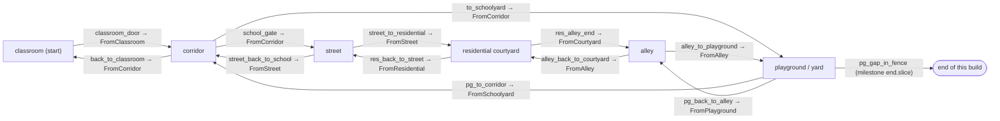
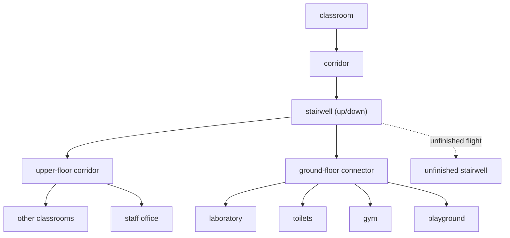
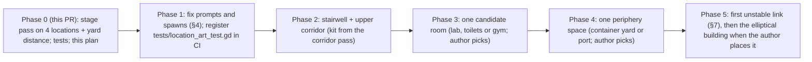

# Map plan: the school and what lies around it

Chinese reading copy: `docs/MAP_PLAN.zh-CN.md`. This document is canonical; keep the pair in
step.

The README's route (classroom → corridor → street → courtyard → alley → yard) is the
**current slice**, not the map. This plan records what exists, what is fixed but not built,
what is proposed, and what only the author can decide. Every item carries one status label:

| Label | Meaning |
|---|---|
| **已实现** (implemented) | In the repository and reachable in a build today. |
| **已确定但未实现** (decided, not built) | Stated in `docs/NARRATIVE_BIBLE.md` or by the owner; no scene yet. |
| **建议新增** (proposed) | A suggestion from this plan. Nothing depends on it. |
| **尚待作者决定** (author's call) | Story or structure the plan must not settle. |

Story limits this plan keeps: the elliptical building is a later structure connecting
versions of the school — not in the opening, not a generic portal. The green animal's
species and outcome, and the content of the A/B/C memories, are undecided. No text here
comes from the manuscript.

## 1. Implemented locations

| Location id | Scene | What it is now | Status |
|---|---|---|---|
| `classroom` | `scenes/locations/classroom/classroom.tscn` | Start (`PlayerStart`). The painted classroom; the wake and the free period. | 已实现 |
| `corridor` | `scenes/locations/corridor/corridor.tscn` | Open walkway on the building's side: wall and classroom door on the west, parapet over the yard on the east, gate stairs south, yard door north. Stage pass: green wainscot that sinks towards the yard door, converging terrazzo strips, a leaning upper storey whose windows shrink, a tall yard door with a lit transom, the yard far below with a court fragment and a too-small hoop, the sky laid flat under it all. | 已实现 |
| `street` | `scenes/locations/street/street.tscn` | School wall (west) with barred windows, a road with a broken centre line and a crossing missing one bar, rose flats and an ochre shop (east), a stair up to the flats' passage. The road runs off its north end into the laid-flat sky; a blank sign stands out there. | 已实现 |
| `residential` | `scenes/locations/residential/residential.tscn` | Courtyard of three blocks in three slightly-wrong colours (yellow, rose, sage); slide, planter, washing line, bench, chair, the animal; chalk hopscotch with one square drawn twice; water tanks and a leaning aerial on the roofs; one long lit window that is off the grid. | 已实现 |
| `alley` | `scenes/locations/alley/alley.tscn` | 7 m lane between cold blue streaked walls; the west wall carries on above its coping and leans over the lane; a bay with a service door; skip with a chair in it; the gate to the yard, with light beyond it; close cut-out rooftops at the wrong scale. | 已实现 |
| `playground` | `scenes/locations/playground/playground.tscn` | The yard (key location): red court, school back wall, shed, container, tree, fence with a gap, estate. This round adds a fence run that carries on past the open west edge and sinks into the sky, a 20 m floodlight mast standing in the sky, and one chair out there facing the yard. | 已实现 |

Screenshots of every change: `docs/screenshots/map_art/before/` and `after/` (CI frames
from `.github/workflows/location-art-capture.yml`).

## 2. Connections (current)



All of the above: **已实现**. The graph is a loop (school → town → back into the school
through the yard), which is the slice's one spatial surprise: the yard reached from outside
is the same yard behind the corridor.

## 3. Landmarks

| Landmark | Where | Use | Status |
|---|---|---|---|
| Yard door with a lit transom | corridor, north end | Pulls the eye down the walkway; the "other side" of the corridor | 已实现 |
| Court fragment and small hoop below the parapet | corridor, east | Shows the yard before it is reachable | 已实现 |
| Blank sign standing in the sky | street, past the road's north end | Marks the end of the walkable town without a wall | 已实现 |
| School wall with barred windows | street, west | Keeps the school present while outside it | 已实现 |
| Long lit window off the grid | courtyard, north block | The one wrong thing in an ordinary block | 已实现 |
| Water tanks, leaning aerial | courtyard roofs | Silhouette; reads "housing" from above | 已实现 |
| Leaning west wall, light past the gate | alley | Narrowing; a goal at the end of the lane | 已实现 |
| Gap in the fence | yard, north | The slice's ending | 已实现 |
| Fence run sinking into the sky; floodlight mast; the chair | yard, west distance | Boundary that is not continuous; scale that is wrong; waiting | 已实现 |
| The elliptical building | not placed | A later structure connecting versions of the school | 已确定但未实现; where and when: 尚待作者决定 |

## 4. Weaknesses found in this review

| Finding | Detail | Status / suggestion |
|---|---|---|
| Unused spawn `playground/FromSchool` | No exit targets it; a near-duplicate of `FromCorridor` | 建议新增: remove, or keep for a future school-interior door into the yard |
| Spawn `residential/FromStair` on a look-only landing | The west stair goes nowhere yet | 建议新增: the stair is the natural hook for "upstairs flats" (§6); until then keep it unused |
| Prompt mismatch: alley → courtyard says "Go back to the street" | `prompt.back_to_street` reused | 建议新增: a `prompt.back_to_courtyard` key (both locales) |
| Prompt mismatch: street → corridor says "Return to classroom" | `prompt.back_to_classroom` reused | 建议新增: `prompt.back_into_school` |
| Prompt: courtyard → alley says "Keep walking" (`prompt.milestone`) | The key name dates from when the alley was the end | 建议新增: rename the key; text can stay |
| Objectives are ambient ("Nothing asks you to be anywhere") | Intended tone; no wayfinding role | Keep; 尚待作者决定 whether any location ever gets a directive objective |
| Corridor and street are one-sided stages | The camera never sees the east side of the street or the west side of the walkway | Accepted for an isometric follow camera; new rooms should be authored for the same view |
| Only one way into the school interior | The classroom; no stairs, no other rooms | §5 |
| Story state is all "arrival" flags | `left_classroom`, `left_school`, `*_arrived`; no flag changes a space | 尚待作者决定: which spaces change on return (see §7) |

## 5. Expansions inside the campus



| Space | Narrative function | Exploration purpose | Scene or zone | Status |
|---|---|---|---|---|
| Stairwell | The vertical joint of the school; the first place where floors could disagree | Choice of up/down; landmarks on landings | Separate scene (`stairwell`), entered from the corridor's south end or a new door | 建议新增 |
| Upper-floor corridor | Repetition of the walkway with one change | Compare against memory of the first corridor | Separate scene, built from the corridor's stage kit | 建议新增 |
| Other classrooms | Rooms that look like the first one and are not | Short visits, one object each | Zones inside the upper corridor scene (door + shallow room), not full scenes | 建议新增 |
| Staff office | Authority without people; papers | One inspectable desk, the rota's origin | Separate small scene | 建议新增 |
| Laboratory, toilets, gym | Named in the narrative bible as candidate spaces; order not fixed | Each a single-room scene | Separate scenes | 已确定但未实现 (as candidates); order 尚待作者决定 |
| Unfinished stairwell | Named as a candidate space | A flight that stops; a view out | Zone of the stairwell scene | 已确定但未实现 (candidate) |
| Ground-floor connector | Joins stairs, rooms and the yard's `FromSchool` spawn | Gives `FromSchool` a use | Separate scene or zone of the stairwell | 建议新增 |

## 6. Expansions around the campus

| Space | Narrative function | Exploration purpose | Scene or zone | Status |
|---|---|---|---|---|
| Upstairs flats (via `residential/FromStair`) | Inside an ordinary home block | One landing, one open door | Separate scene | 建议新增 |
| Shop interior (street) | Daily life with the shutter half up | One counter | Zone of the street (shallow) | 建议新增 |
| Container yard | Named as a candidate space | Stacks as a maze of corridors, seen from above | Separate scene | 已确定但未实现 (candidate) |
| Port-like area | Named as a candidate space | Edge of the world; water as the laid-flat sky | Separate scene | 已确定但未实现 (candidate) |
| Road north of the street (past the blank sign) | The town that does not continue | A walk that ends in the sky | Extension of the street scene | 建议新增; whether it is ever walkable: 尚待作者决定 |

## 7. Future unstable or non-Euclidean links

These are proposals for *how* links could misbehave, not decisions that they do.

| Idea | Mechanism (fits the transition transaction) | Status |
|---|---|---|
| The yard door leads to a yard that is not the same yard | Exit with a flag-conditioned `destination_scene` | 建议新增 |
| The stairwell has one floor more going down than going up | Two stairwell scenes whose exits point at each other asymmetrically | 建议新增 |
| Returning to the corridor from the street after a flag shows a changed walkway | Scene variant or state-driven visibility in the corridor | 建议新增 |
| The elliptical building as the place where versions of the school meet | — | 已确定但未实现 as a later structure; placement, entry and rules 尚待作者决定 |

All of these must stay inside the existing scene-transition transaction and keep one
`NavigationRegion3D` per location; none needs a portal system.

## 8. Narrative function and exploration purpose (current areas)

| Area | Narrative function | Exploration purpose | Status |
|---|---|---|---|
| classroom | Waking; the ordinary day that is not | Desk, board, door | 已实现 |
| corridor | Leaving; the first wrong perspective | Noticeboard, speaker, trolley, glass, the wait at the rail | 已实现 |
| street | Outside, but the school is still the biggest thing | Notice pole, bins, camera, puddle | 已实现 |
| residential | Somebody's home life, overheard | The animal, the stains, washing, the chair | 已实现 (animal's role: 尚待作者决定) |
| alley | Pressure; the way narrows | The skip and its chair, notices, the service door | 已实现 |
| playground | Waiting; the open stage | Hasp, rota, moved hoop, stamped tag; the gap | 已实现 (the middle of the yard is reserved for events) |

## 9. Separate scenes or zones

Rule used above: a **separate scene** when the space has its own exits, its own camera
problems or its own story state; a **zone** when it is a shallow room off a corridor that
the player enters and leaves through one door. Each separate scene gets an entry in
`data/story/locations.json`, one `NavigationRegion3D`, spawn markers named `From<Origin>`
and exits whose prompts name where they lead.

## 10. Phased development order



| Phase | Content | Status |
|---|---|---|
| 0 | Stage pass on corridor, street, courtyard, alley; yard distance additions; `tests/location_art_test.gd`; this plan | 已实现 (this pull request) |
| 1 | Prompt keys, unused spawns, CI registration of the new test | 建议新增 |
| 2 | Stairwell and upper corridor | 建议新增 |
| 3 | First candidate room | 已确定但未实现 (candidates); choice 尚待作者决定 |
| 4 | First periphery space | 已确定但未实现 (candidates); choice 尚待作者决定 |
| 5 | Unstable links; elliptical building | 建议新增 / 尚待作者决定 |

## Tests

`tests/location_art_test.gd` checks the stage pass: no collider in its nodes, the same
collider count per location, every spawn, interactable count and exit (destination and
spawn) as on main at `6cdf037`, outline paths, routes from every spawn to every exit,
materials and texture sizes, the distance staying under the floors and out of the light,
no piece on a sight line of the follow camera, and lighting that is not murk. It is **not
yet registered in `.github/workflows/godot-ci.yml`**, because another open pull request is
changing that file; until then `.github/workflows/location-art-capture.yml` runs it (job
`location art test`). Registering it is phase 1.

Rebuild order for the dressed scenes:

```sh
python3 scenes/environment/props/stage_art/source/paint_stage_textures.py
python3 tools/build_outdoor_locations.py street residential alley playground
python3 scenes/environment/props/playground_art/source/build_playground_art.py
python3 scenes/environment/props/stage_art/source/build_stage_art.py
```

The stage builder is idempotent, so the hand-authored corridor can be re-dressed in place.
