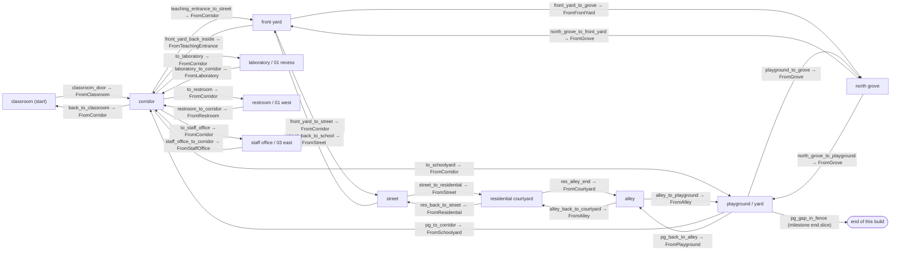
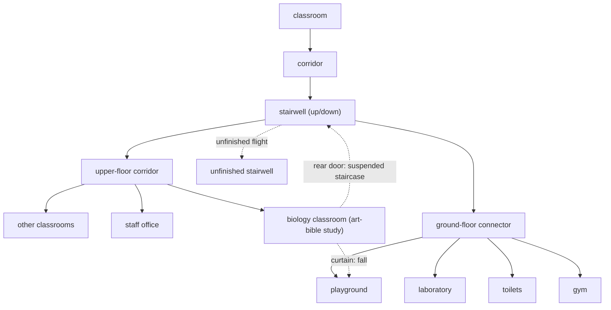
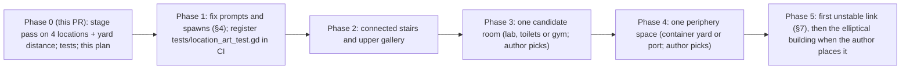

# Map plan: the school and what lies around it

Chinese reading copy: `docs/MAP_PLAN.zh-CN.md`. This document is canonical; keep the pair in
step.

The README's route (classroom → corridor → street → courtyard → alley → yard) is the
**current slice**, not the map. This plan records what exists, what is fixed but not built,
what is proposed, and what only the author can decide. Every item carries one status label:

| Label | Meaning |
|---|---|
| **已实现** (implemented) | In the repository and reachable in a build today. |
| **已确定但未实现** (decided, not built) | Stated in `docs/NARRATIVE_BIBLE.md` or by the owner; no scene yet. |
| **建议新增** (proposed) | A suggestion from this plan. Nothing depends on it. |
| **尚待作者决定** (author's call) | Story or structure the plan must not settle. |

Story limits this plan keeps: the elliptical building is a later structure connecting
versions of the school — not in the opening, not a generic portal. The green animal's
species and outcome, and the content of the A/B/C memories, are undecided. No text here
comes from the manuscript.

## 1. Implemented locations

| Location id | Scene | What it is now | Status |
|---|---|---|---|
| `classroom` | `scenes/locations/classroom/classroom.tscn` | Start (`PlayerStart`). The painted classroom; the wake and the free period. | 已实现 |
| `corridor` | `scenes/locations/corridor/corridor.tscn` | Three connected storeys: the big two-leaf glass doors (a click out to the front yard's porch, round 25), the directory and a side door to the stable lane on 01, biology on 02, and a loop to the upper gallery on 03. Optional doors in the end bays are listed below. The original fire stair still goes to `playground`. See [CORRIDOR_ART.md](CORRIDOR_ART.md). | 已实现 |
| `front_yard` | `scenes/locations/front_yard/front_yard.tscn` | Round 16. Out of the 01 glass doors onto a porch, three steps above the front yard (前操场, round 25): bare loess dirt with a trodden path and dry grass at the edges, no road. Seven dead trees, a low railing north and south with more dirt sports ground past it, so the teaching block has playground on both sides. East is the school wall (围墙) with the school gate (校门) in it: a parking-lot retractable gate (伸缩门), shut, and beside it a side door (小门) one person wide, with a card reader (刷卡机) on its pier just inside. The reader is look-only; the door opens without a card. Three inspections, owner text still TODO. | 已实现 |
| `north_grove` | `scenes/locations/north_grove/north_grove.tscn` | Round 26. The north grove (北面枯树小道): a mirrored L of dead trees between iron railings (铁栏杆) and the school wall, hugging the grounds' north-east corner - north beside the front yard's school gate, then west along the north wall to the court's opening (the one gap the wall leaves). Reached from both yards by click exits; see [CORRIDOR_ART.md](CORRIDOR_ART.md), round 26. | 已实现 |
| `street` | `scenes/locations/street/street.tscn` | Reached only through the school gate's side door (round 16). West is the school wall (围墙) with the gate at its south end and an ivory dado along its foot; over it, the front yard's dirt, its dead trees and the teaching block with its barred windows stand back out of reach. Then a road with a broken centre line and a crossing missing one bar, rose flats and an ochre shop (east), a stair up to the flats' passage. The gutter is an open ditch under the school-side kerb: lined, its water holding a pale strip of sky, bare cracked earth on its road side, precast slabs over it from the crossing to the school gate, and a drain cover higher than the water that runs to it. The road runs off its north end into the laid-flat sky; a blank sign stands out there, and a pale ribbed panel stands in the ditch's line. | 已实现 |
| `residential` | `scenes/locations/residential/residential.tscn` | Courtyard of three blocks in three slightly-wrong colours (yellow, rose, sage); slide, planter, washing line, bench, chair, the animal; chalk hopscotch with one square drawn twice; water tanks and a leaning aerial on the roofs; one long lit window that is off the grid. | 已实现 |
| `alley` | `scenes/locations/alley/alley.tscn` | 7 m lane between cold blue streaked walls; the west wall carries on above its coping and leans over the lane; a bay with a service door; skip with a chair in it; the gate to the yard, with light beyond it; close cut-out rooftops at the wrong scale. | 已实现 |
| `playground` | `scenes/locations/playground/playground.tscn` | The yard (key location): red court, school back wall, shed, container, tree, fence with a gap, estate. This round adds a fence run that carries on past the open west edge and sinks into the sky, a 20 m floodlight mast standing in the sky, and one chair out there facing the yard. Round 20: rough concrete court, the rest of the yard in pale square concrete slabs, the shed moved to the north-east corner beside the container, and a square of soil in the open west with a giant saguaro and a girl skipping beside it. | 已实现 |
| `laboratory` | `scenes/locations/laboratory/laboratory.tscn` | Behind the 01 return wall. Cold working room with two inset bowls, supported glassware and a running mixer. Nine inspections; return to the recess. | 已实现 |
| `restroom` | `scenes/locations/restroom/restroom.tscn` | West end of 01. Twin basins, an open cubicle beside a closed one, and a repaired tile at the drain. Three optional observations; return to the same landing. | 已实现 |
| `staff_office` | `scenes/locations/staff_office/staff_office.tscn` | East end of 03. An unstaffed desk, dispatch trays and a key rail. Three optional observations; return to the same landing. | 已实现 |
| `restroom_02`, `restroom_03` | `scenes/locations/<id>/<id>.tscn` | Ordinary restrooms at the east ends of 02 and 03; return to the same door, no check. | 已实现 |
| `archive`, `plan_room`, `projection_room`, `computer_room`, `vacant_office`, `principal_office` | `scenes/locations/<id>/<id>.tscn` | Two optional rooms per storey: read, test Orientation, then see the matched misregistration inside. See [CORRIDOR_ART.md](CORRIDOR_ART.md) for placements. | 已实现 |

Screenshots of the exterior pass: `docs/screenshots/map_art/before/` and `after/` (CI frames
from `.github/workflows/location-art-capture.yml`).

## 2. Connections (current)



All of the above: **已实现**. The graph is a loop (school → town → back into the school
through the yard), which is the slice's one spatial surprise: the yard reached from outside
is the same yard behind the corridor.

## 3. Landmarks

| Landmark | Where | Use | Status |
|---|---|---|---|
| Red fire door and fire stair | corridor, lower east wing | Yard entry and return landing | 已实现 |
| Painted court, hoops and shed through the glass | corridor, courtside galleries | Shows the same yard before it is reached | 已实现 |
| Blank sign standing in the sky | street, past the road's north end | Marks the end of the walkable town without a wall | 已实现 |
| School wall and gate; the teaching block over it | street, west | Keeps the school present while outside it | 已实现 |
| Retractable gate, side door and card reader | front yard, east | The way out is one person wide | 已实现 |
| Dead trees on bare dirt | front yard | Playground on both sides of the block, with nothing growing | 已实现 |
| The grove's railings and its dead trees | north grove | A strip that keeps you at the wall, tree by tree | 已实现 |
| Long lit window off the grid | courtyard, north block | The one wrong thing in an ordinary block | 已实现 |
| Water tanks, leaning aerial | courtyard roofs | Silhouette; reads "housing" from above | 已实现 |
| Leaning west wall, light past the gate | alley | Narrowing; a goal at the end of the lane | 已实现 |
| Gap in the fence | yard, north | The slice's ending | 已实现 |
| Fence run sinking into the sky; floodlight mast; the chair | yard, west distance | Boundary that is not continuous; scale that is wrong; waiting | 已实现 |
| The elliptical building | not placed | A later structure connecting versions of the school | 已确定但未实现; where and when: 尚待作者决定 |

## 4. Weaknesses found in this review

| Finding | Detail | Status / suggestion |
|---|---|---|
| Unused spawn `playground/FromSchool` | No exit targets it; a near-duplicate of `FromCorridor` | 建议新增: remove, or keep for a future school-interior door into the yard |
| Spawn `residential/FromStair` on a look-only landing | The west stair goes nowhere yet | 建议新增: the stair is the natural hook for "upstairs flats" (§6); until then keep it unused |
| Prompt mismatch: alley → courtyard says "Go back to the street" | `prompt.back_to_street` reused | 建议新增: a `prompt.back_to_courtyard` key (both locales) |
| School return | The front yard's glass-door exit uses `prompt.back_inside` and lands inside the 01 glass doors; the street's side door uses `prompt.back_to_school` and lands in the front yard. | 已实现 |
| Prompt: courtyard → alley says "Keep walking" (`prompt.milestone`) | The key name dates from when the alley was the end | 建议新增: rename the key; text can stay |
| Objectives are ambient ("Nothing asks you to be anywhere") | Intended tone; no wayfinding role | Keep; 尚待作者决定 whether any location ever gets a directive objective |
| Corridor and street are one-sided stages | The camera never sees the east side of the street or the west side of the walkway | Accepted for an isometric follow camera; new rooms should be authored for the same view |
| Only one way into the school interior | The classroom; no stairs, no other rooms | §5 |
| Story state is all "arrival" flags | `left_classroom`, `left_school`, `*_arrived`; no flag changes a space | 尚待作者决定: which spaces change on return (see §7) |

## 5. Expansions inside the campus



| Space | Narrative function | Exploration purpose | Scene or zone | Status |
|---|---|---|---|---|
| Stairwell | The vertical joint of the school; the first place where floors could disagree | Choice of up/down; an offset half landing | Two continuous connections inside `corridor` | 已实现 |
| Upper-floor corridor | Repetition of the walkway with one change | Five bays, a turn and repeated room plates | Connected inside `corridor`; no location load | 已实现 |
| Other classrooms | Rooms that look like the first one and are not | Jump to observe the interiors; opening further doors is a separate feature | Shallow furnished interiors behind high glass | 部分实现 |
| Staff office | Authority without people; unfinished clerical work | Duty-sheet master, trays and empty hook; no inference about the courtyard rota | 03 east end, `staff_office` | 已实现 |
| Laboratory | A working room with a palette of its own | Nine optional observations, no new objective | 01 recess, `laboratory` | 已实现 |
| Restroom | Ordinary neglect without an explanation | Squat pans, urinals, standing water, flies; keep the basin, latch and grate inspections | 01 west and 02/03 east ends | 已实现 |
| Six registration rooms | Alignment means more than trusting a landmark | Inspect paired marks, check Scrutiny/Inference or align by hand, then see the displaced counterpart inside | Two per storey, return to each respective door | 已实现 |
| Gym | Candidate in the narrative bible | Not ordered on the route | Separate scene if chosen | 已确定但未实现 (candidate) |
| Unfinished stairwell | Named as a candidate space | A flight that stops; a view out | Zone of the stairwell scene | 已确定但未实现 (candidate) |
| Ground-floor connector | Joins stairs, rooms and the yard's `FromSchool` spawn | Gives `FromSchool` a use | Separate scene or zone of the stairwell | 建议新增 |

### Location studies approved in the art bible

`docs/ART_BIBLE.md` ("Postmodern spatial language and visual plurality", merged to main
after this plan was started) lists approved creative directions. They are directions for
exploration, not implemented content; this plan places them only as far as the bible does.

| Study | Map consequence | Scene or zone | Status |
|---|---|---|---|
| Biology classroom: a blue curtain conceals a cut through the west wall | A one-way route from an upper classroom to `playground`, separate from the normal corridor/yard entrances | Existing `classroom` and `playground` scenes | **Implemented:** failed Scrutiny check slips and injures a foot on `FromSchool`; success stays upstairs until a voluntary drop. Both land on the container roof and use its ladder to reach the yard. |
| Biology classroom: the rear door opens onto a staircase suspended in the room | A vertical link that does not fit the building | Zone of the biology classroom | **Withdrawn from `classroom` in issue #159**: the rear door (`WallEast/RearDoor`, white, in the east wall behind the front door) never opens, "unless special means are used", and no staircase is placed. What those means are, and where the staircase goes: 尚待作者决定 |
| Mirror-lined crawlspace or pipe | A narrow connector between two places | Short separate scene | 已确定但未实现; what it connects: 尚待作者决定 |
| The schoolyard's impossible animals (a crocodile or a lion, as examples) | Occupants of the yard, calm, not combat | Inside `playground` (the yard's middle is reserved for events) | 已确定但未实现; relation to the green animal: 尚待作者决定 |
| A laboratory with its own medium | Optional detour off 01, with a cold studio palette and instrumentation | `laboratory` | 已实现 |

### School layout (round 25, the owner's plan)

The owner's picture of the campus: the teaching block stands inside the school wall (one
side may be open); the dirt front yard (`front_yard`) east of it and the court
(`playground`) west of it both stay as they are. North of the block a very narrow passage
of dead trees between iron railings, a mirrored L: from beside the front yard's school
gate north, then west along the north wall to the court and on. South: the sports
equipment, moved off the court. Elsewhere: school buildings such as a gym.

| Phase | Content | Status |
|---|---|---|
| 1 | Out of 01 by a big two-leaf glass door facing east (down the blue stair); a click lands the player on a porch's steps above the dirt yard, and they walk down onto it. The 02 gate steps and the small forecourt are gone; a plain side door from the 01 gallery leads to the stable lane. See [CORRIDOR_ART.md](CORRIDOR_ART.md), round 25. | 已实现 |
| 2 | The school wall round the block, and the north grove as a new walkable location joining the two yards. Round 26: the wall's north runs and the grove are in; the rail gaps by the porch steps are closed. | 已实现 |
| 3 | The sports equipment south, a gym, distant buildings lined up with the map | 部分实现 (round 27: the equipment room 器材室 with the yard's stored gear stands in the front yard's north-east corner; the gym 体育馆 rises beyond the school wall's north-east corner - a shell only, its interior is future work; the block's north door 北门 opens from the lower walk's east glazing onto the dirt at the face's north-east corner; the distant rows line up south) |

## 6. Expansions around the campus

| Space | Narrative function | Exploration purpose | Scene or zone | Status |
|---|---|---|---|---|
| Upstairs flats (via `residential/FromStair`) | Inside an ordinary home block | One landing, one open door | Separate scene | 建议新增 |
| Shop interior (street) | Daily life with the shutter half up | One counter | Zone of the street (shallow) | 建议新增 |
| Container yard | Named as a candidate space | Stacks as a maze of corridors, seen from above | Separate scene (`container_yard`) | 已实现 (round 13; through the cut chain-link behind the schoolyard's blue container) |
| Port-like area | Named as a candidate space | Edge of the world; water as the laid-flat sky | Separate scene (`port`) | 已实现 (round 14; by the truck in the container yard, its box bound for the dock) |
| Road north of the street (past the blank sign) | The town that does not continue | A walk that ends in the sky | Extension of the street scene | 建议新增; whether it is ever walkable: 尚待作者决定 |

## 7. Future unstable or non-Euclidean links

These are proposals for *how* links could misbehave, not decisions that they do.

| Idea | Mechanism (fits the transition transaction) | Status |
|---|---|---|
| The yard door leads to a yard that is not the same yard | Exit with a flag-conditioned `destination_scene` | 建议新增 |
| The stairwell has one floor more going down than going up | Two stairwell scenes whose exits point at each other asymmetrically | 建议新增 |
| Returning to the corridor from the street after a flag shows a changed walkway | Scene variant or state-driven visibility in the corridor | 建议新增 |
| The biology classroom's curtain: a fall from an upper floor that lands in the yard | One-way staged route through the cut to the container roof (`FromSchool`), then down the ladder | 已实现 (see Location studies above) |
| The elliptical building as the place where versions of the school meet | — | 已确定但未实现 as a later structure; placement, entry and rules 尚待作者决定 |

All of these must stay inside the existing scene-transition transaction and keep one
`NavigationRegion3D` per location; none needs a portal system.

## 8. Narrative function and exploration purpose (current areas)

| Area | Narrative function | Exploration purpose | Status |
|---|---|---|---|
| classroom | Waking; the ordinary day that is not | Desk, board, door | 已实现 |
| corridor | Leaving; the first wrong perspective | Noticeboard, speaker, trolley, glass, the wait at the window; the offset stair and lab recess controls | 已实现 |
| front_yard | Out of the building, still inside the walls | Dead trees, the shut gate, the card reader; the equipment room's shut door and its stored gear (round 27) | 已实现 (inspection text: 尚待作者决定) |
| street | Outside, but the school is still the biggest thing | Notice pole, bins, camera, puddle | 已实现 |
| residential | Somebody's home life, overheard | The animal, the stains, washing, the chair | 已实现 (animal's role: 尚待作者决定) |
| alley | Pressure; the way narrows | The skip and its chair, notices, the service door | 已实现 |
| playground | Waiting; the open stage | Hasp, rota, moved hoop, stamped tag; the gap | 已实现 (the middle of the yard is reserved for events) |

The two [service controls](CORRIDOR_ART.md#service-controls-and-the-edge-of-the-set) are small local events in the existing corridor, not new links. The offset stair shutter changes the section on view without opening the void guard. The 01 bell register stages a delayed blank. The southern street barrier marks the end of the physical road, with in-place fall recovery beyond other edges.

## 9. Separate scenes or zones

Rule used above: a **separate scene** when the space has its own exits, its own camera
problems or its own story state; a **zone** when it is a shallow room off a corridor that
the player enters and leaves through one door. Each separate scene gets an entry in
`data/story/locations.json`, one `NavigationRegion3D`, spawn markers named `From<Origin>`
and exits whose prompts name where they lead.

## 10. Phased development order



| Phase | Content | Status |
|---|---|---|
| 0 | Stage pass on corridor, street, courtyard, alley; yard distance additions; `tests/location_art_test.gd`; this plan | 已实现 (this pull request) |
| 1 | Prompt keys, unused spawns, CI registration of the new test | 建议新增 |
| 2 | Stairwell and upper corridor | 已实现：三层、共用折梯与保留的环路，见 [CORRIDOR_ART.md](CORRIDOR_ART.md) |
| 3 | First candidate rooms | 已实现: laboratory and restroom; the staff office is another optional visit. The gym and later room order remain undecided. |
| 4 | First periphery spaces | 已实现: the container yard (round 13) and the port past it (round 14); their lines are still the owner's to write |
| 5 | Unstable links; elliptical building | 建议新增 / 尚待作者决定 |

## Tests

`tests/location_art_test.gd` checks the visual-only stage dressing: no new colliders in
its nodes, unchanged graybox collider counts, original spawn and exit IDs, original
interactables, valid outline paths, reachable exits, small textures and no opaque prop
crossing the follow camera. The structurally expanded teaching block is checked by
`tests/corridor_art_test.gd`, registered as `corridor_art` in the main Godot checks.
The stage test still runs in Location art capture; its main-workflow registration is
separate from the teaching block.

Rebuild order for the dressed scenes:

```sh
python3 scenes/environment/props/stage_art/source/paint_stage_textures.py
python3 scenes/environment/props/stage_art/source/paint_street_ditch.py
python3 scenes/environment/props/stage_art/source/paint_front_yard.py
python3 tools/build_outdoor_locations.py front_yard street residential alley playground
python3 scenes/environment/props/playground_art/source/build_playground_art.py
python3 scenes/environment/props/stage_art/source/build_stage_art.py
```

The stage builder is idempotent for the front yard, street, residential and alley; it also writes the front yard's meshes (`front_yard_meshes.py`). Run `python3 tools/build_teaching_block.py` for the corridor instead.
