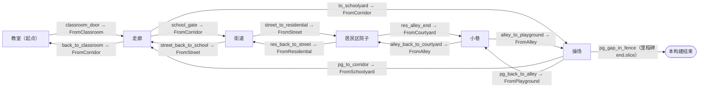
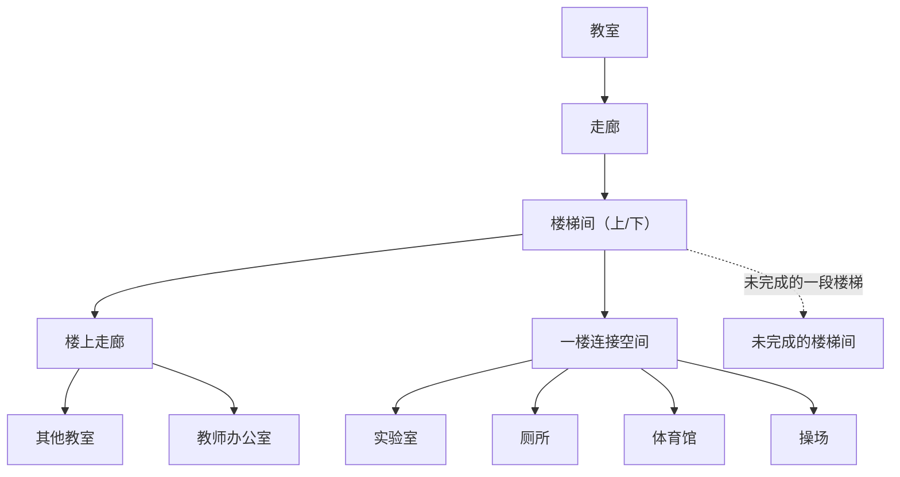

# 地图规划：学校与学校周边

英文正本：`docs/MAP_PLAN.md`（以英文为准，两份需同步更新）。

README 里的路线（教室 → 走廊 → 街道 → 居民区 → 小巷 → 操场）只是**当前切片**，不是整张地图。本文记录已有内容、已确定但未建的内容、建议新增的内容，以及只能由作者决定的内容。每一项都带一个状态标签：

| 标签 | 含义 |
|---|---|
| **已实现** | 已在仓库中，当前构建可以到达。 |
| **已确定但未实现** | 已写入 `docs/NARRATIVE_BIBLE.md` 或由作者确认，但还没有场景。 |
| **建议新增** | 本规划提出的建议，没有任何内容依赖它。 |
| **尚待作者决定** | 本规划不应替作者决定的剧情或结构。 |

本规划遵守的剧情限制：椭圆形建筑是后期出现、连接不同版本学校的结构——不出现在开场，也不是通用传送门。绿色动物的物种与结局、A/B/C 记忆的内容都尚未决定。本文没有引用手稿原文。

## 1. 已实现的地点

| 地点 id | 场景 | 现状 | 状态 |
|---|---|---|---|
| `classroom` | `scenes/locations/classroom/classroom.tscn` | 起点（`PlayerStart`）。手绘风格教室；醒来与自习。 | 已实现 |
| `corridor` | `scenes/locations/corridor/corridor.tscn` | 教学楼外侧的开放走廊：西侧是墙和教室门，东侧是俯瞰操场的女儿墙，南端是去校门的台阶，北端是通往操场的门。本轮舞台化：越往操场门越低的绿色墙裙、逐渐收拢的水磨石铜条、向外倾斜且窗户越来越小的上层楼体、顶部有亮光气窗的高门、远在下方的操场（一块球场碎片和一个偏小的篮架）、铺在脚下的天空。 | 已实现 |
| `street` | `scenes/locations/street/street.tscn` | 西侧是带铁栅窗的学校外墙，路面中线断断续续、斑马线少一道，东侧是玫瑰色住宅楼和赭黄色商店，楼梯通往住宅楼的过道。道路北端直接伸进铺平的天空，那里立着一块空白路牌。 | 已实现 |
| `residential` | `scenes/locations/residential/residential.tscn` | 三栋颜色都有点“不对”的楼（黄、玫瑰、灰绿）围成的院子；滑梯、花坛、晾衣绳、长椅、椅子、绿色动物；粉笔跳房子，其中一格被画了两次；楼顶有水箱和一根歪的天线；北楼有一扇不在窗格网格上的长条亮窗。 | 已实现 |
| `alley` | `scenes/locations/alley/alley.tscn` | 两堵冷蓝色、带雨痕的墙夹着 7 米宽的巷子；西墙越过压顶继续往上，并向巷内倾斜；有一个带检修门的凹口；装着椅子的垃圾箱；通往操场的门，门后是光；近处尺度不对的剪影屋顶。 | 已实现 |
| `playground` | `scenes/locations/playground/playground.tscn` | 操场（重点地点）：红色球场、学校后墙、小屋、集装箱、树、有缺口的围栏、住宅区。本轮新增：一段越过开放西缘继续延伸、逐渐沉入天空的围栏；一根立在天空里的 20 米灯杆；一把面向操场的椅子。 | 已实现 |

每处改动的前后截图：`docs/screenshots/map_art/before/` 与 `after/`（由 `.github/workflows/location-art-capture.yml` 在 CI 中拍摄）。

## 2. 当前连接



以上全部：**已实现**。整张图是一个环（学校 → 镇上 → 经操场回到学校）：从外面走到的操场，就是走廊背后的那个操场——这是当前切片唯一的空间意外。

## 3. 地标

| 地标 | 位置 | 作用 | 状态 |
|---|---|---|---|
| 带亮光气窗的操场门 | 走廊北端 | 把视线拉向走廊尽头；走廊的“另一边” | 已实现 |
| 女儿墙下的球场碎片与小篮架 | 走廊东侧 | 在能走到操场之前先让人看见它 | 已实现 |
| 立在天空里的空白路牌 | 街道北端之外 | 不用墙也能标出可走范围的尽头 | 已实现 |
| 带铁栅窗的学校外墙 | 街道西侧 | 人在校外，学校依然在场 | 已实现 |
| 不在网格上的长条亮窗 | 居民区北楼 | 普通楼里唯一不对劲的地方 | 已实现 |
| 水箱、歪天线 | 居民区楼顶 | 轮廓；从高处一看就是住宅 | 已实现 |
| 倾斜的西墙、门后的光 | 小巷 | 收窄；巷子尽头的目标 | 已实现 |
| 围栏缺口 | 操场北侧 | 当前切片的结尾 | 已实现 |
| 沉入天空的围栏、灯杆、椅子 | 操场西侧远景 | 不连续的边界；不对的尺度；等待 | 已实现 |
| 椭圆形建筑 | 未放置 | 后期出现、连接不同版本学校的结构 | 已确定但未实现；位置与时机：尚待作者决定 |

## 4. 本次审查发现的问题

| 问题 | 说明 | 状态 / 建议 |
|---|---|---|
| 未使用的出生点 `playground/FromSchool` | 没有出口指向它；与 `FromCorridor` 几乎重复 | 建议新增：删除，或留给将来从教学楼内部进入操场的门 |
| `residential/FromStair` 在一个只能看的平台上 | 西侧楼梯目前不通往任何地方 | 建议新增：这段楼梯是“楼上住户”（第 6 节）的天然入口；在那之前保持不用 |
| 提示不符：小巷 → 院子显示“回到街上” | 复用了 `prompt.back_to_street` | 建议新增：`prompt.back_to_courtyard`（两种语言） |
| 提示不符：街道 → 走廊显示“回教室” | 复用了 `prompt.back_to_classroom` | 建议新增：`prompt.back_into_school` |
| 提示：院子 → 小巷显示“继续走”（`prompt.milestone`） | 键名来自小巷还是终点的时候 | 建议新增：改键名，文字可以不变 |
| 目标文字是氛围性的（“没有什么要求你去任何地方”） | 有意为之，不承担引路功能 | 保留；是否有地点需要明确目标：尚待作者决定 |
| 走廊与街道都是单面舞台 | 镜头永远看不到街道东侧、走廊西侧 | 对等距跟随镜头可以接受；新房间也按同样视角制作 |
| 进入教学楼内部只有一条路 | 只有教室；没有楼梯、没有其他房间 | 见第 5 节 |
| 剧情状态全是“到达”标记 | `left_classroom`、`left_school`、`*_arrived`；没有标记改变空间 | 尚待作者决定：哪些空间在返回时会变化（见第 7 节） |

## 5. 校园内部扩展



| 空间 | 叙事功能 | 探索目的 | 独立场景 / 区域 | 状态 |
|---|---|---|---|---|
| 楼梯间 | 学校的垂直关节；楼层第一次可能对不上的地方 | 上下选择；平台上的地标 | 独立场景（`stairwell`），从走廊南端或新门进入 | 建议新增 |
| 楼上走廊 | 重复第一条走廊，但有一处不同 | 与对第一条走廊的记忆对照 | 独立场景，复用走廊的舞台化套件 | 建议新增 |
| 其他教室 | 看起来像第一间、其实不是的房间 | 短暂进入，每间一个物件 | 楼上走廊场景里的区域（门 + 浅房间），不做完整场景 | 建议新增 |
| 教师办公室 | 没有人的权威；纸张 | 一张可查看的桌子，值日表的来处 | 独立小场景 | 建议新增 |
| 实验室、厕所、体育馆 | 叙事圣经列出的候选空间，顺序未定 | 各为单房间场景 | 独立场景 | 已确定但未实现（作为候选）；顺序尚待作者决定 |
| 未完成的楼梯间 | 叙事圣经列出的候选空间 | 一段到头就断的楼梯；一个往外看的位置 | 楼梯间场景的区域 | 已确定但未实现（候选） |
| 一楼连接空间 | 连接楼梯、房间和操场的 `FromSchool` 出生点 | 让 `FromSchool` 有用 | 独立场景或楼梯间的区域 | 建议新增 |

## 6. 校园周边扩展

| 空间 | 叙事功能 | 探索目的 | 独立场景 / 区域 | 状态 |
|---|---|---|---|---|
| 楼上住户（经 `residential/FromStair`） | 普通住宅楼的内部 | 一个楼梯平台，一扇开着的门 | 独立场景 | 建议新增 |
| 商店内部（街道） | 卷帘门半开的日常 | 一个柜台 | 街道场景的浅区域 | 建议新增 |
| 集装箱堆场 | 叙事圣经列出的候选空间 | 从高处看像迷宫一样的集装箱通道 | 独立场景 | 已确定但未实现（候选） |
| 类似港口的区域 | 叙事圣经列出的候选空间 | 世界的边缘；把水面当作铺平的天空 | 独立场景 | 已确定但未实现（候选） |
| 街道北段（空白路牌之外） | 不再延续的城镇 | 走着走着走进天空 | 街道场景的延伸 | 建议新增；是否可走：尚待作者决定 |

## 7. 将来的不稳定 / 非欧几里得连接

以下只是“连接可以怎样出错”的建议，不代表一定要这样做。

| 想法 | 实现方式（符合场景切换事务） | 状态 |
|---|---|---|
| 操场门通往的不是同一个操场 | 出口的 `destination_scene` 受标记控制 | 建议新增 |
| 楼梯间往下比往上多一层 | 两个楼梯间场景的出口不对称地互相指向 | 建议新增 |
| 某个标记之后从街道回到走廊，走廊变了 | 场景变体，或由状态控制走廊内的可见性 | 建议新增 |
| 椭圆形建筑作为不同版本学校交汇的地方 | — | 作为后期结构：已确定但未实现；位置、入口和规则：尚待作者决定 |

以上都必须在现有场景切换事务之内完成，每个地点保持一个 `NavigationRegion3D`；都不需要传送门系统。

## 8. 当前区域的叙事功能与探索目的

| 区域 | 叙事功能 | 探索目的 | 状态 |
|---|---|---|---|
| 教室 | 醒来；看似平常的一天 | 课桌、黑板、门 | 已实现 |
| 走廊 | 离开；第一次出现不对的透视 | 布告栏、广播、清洁车、玻璃、在栏杆边等待 | 已实现 |
| 街道 | 在校外，但学校仍是最大的东西 | 告示杆、垃圾桶、摄像头、水洼 | 已实现 |
| 居民区 | 偶然听见的别人的家常 | 动物、污渍、晾晒的衣服、椅子 | 已实现（动物的作用：尚待作者决定） |
| 小巷 | 压迫；路在收窄 | 垃圾箱和里面的椅子、告示、检修门 | 已实现 |
| 操场 | 等待；开阔的舞台 | 搭扣、值日表、被挪动的篮架、盖章的标签；缺口 | 已实现（操场中央留给事件） |

## 9. 独立场景还是同一场景内的区域

上文采用的规则：空间有自己的出口、自己的镜头问题或自己的剧情状态时，做**独立场景**；如果只是走廊边上、从一扇门进出的浅房间，就做**区域**。每个独立场景都要在 `data/story/locations.json` 中登记，有一个 `NavigationRegion3D`，出生点命名为 `From<来源>`，出口提示写明通往哪里。

## 10. 分阶段开发顺序


| 阶段 | 内容 | 状态 |
|---|---|---|
| 0 | 走廊、街道、居民区、小巷舞台化；操场远景新增；`tests/location_art_test.gd`；本规划 | 已实现（本 PR） |
| 1 | 提示键、未使用的出生点、新测试登记进 CI | 建议新增 |
| 2 | 楼梯间与楼上走廊 | 建议新增 |
| 3 | 第一个候选房间 | 已确定但未实现（候选）；选哪个：尚待作者决定 |
| 4 | 第一个周边空间 | 已确定但未实现（候选）；选哪个：尚待作者决定 |
| 5 | 不稳定连接；椭圆形建筑 | 建议新增 / 尚待作者决定 |

## 测试

`tests/location_art_test.gd` 检查舞台化改动：新增节点中没有碰撞体；每个地点的碰撞体数量、出生点、可交互物数量和出口（目的地与出生点）都与 main `6cdf037` 一致；描边路径有效；每个出生点都能走到每个出口；材质与贴图大小；远景始终在地面之下且不投影；没有任何新增物件挡住跟随镜头的视线；光照不是一片昏暗。它**尚未登记进 `.github/workflows/godot-ci.yml`**，因为另一个未合并的 PR 正在修改该文件；在此之前由 `.github/workflows/location-art-capture.yml` 的 `location art test` 任务运行。登记它属于阶段 1。

重新生成顺序：

```sh
python3 scenes/environment/props/stage_art/source/paint_stage_textures.py
python3 tools/build_outdoor_locations.py street residential alley playground
python3 scenes/environment/props/playground_art/source/build_playground_art.py
python3 scenes/environment/props/stage_art/source/build_stage_art.py
```

舞台化脚本是幂等的，因此手工制作的走廊可以原地重新处理。
