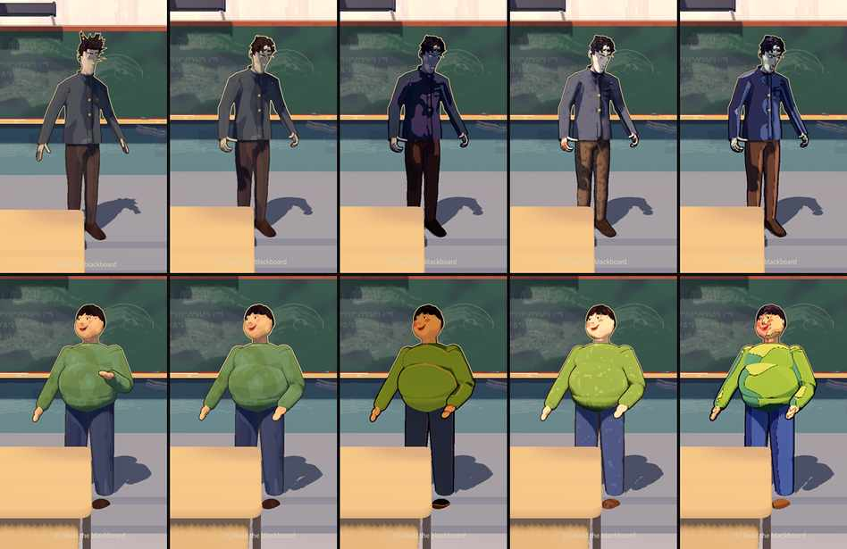
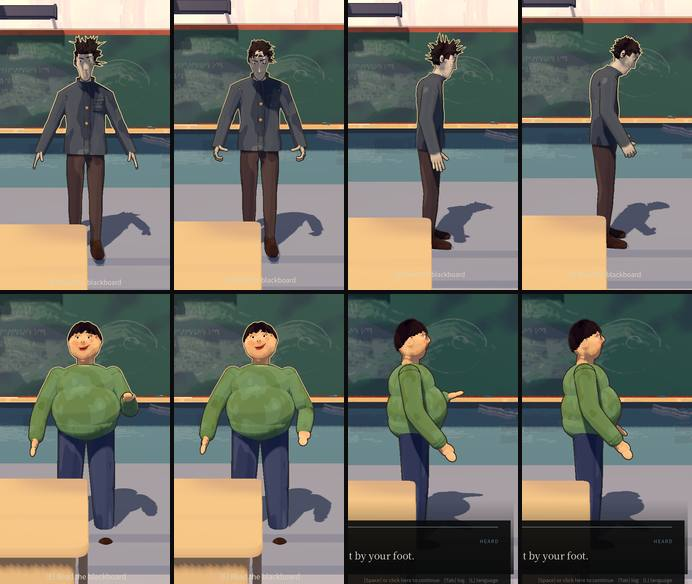
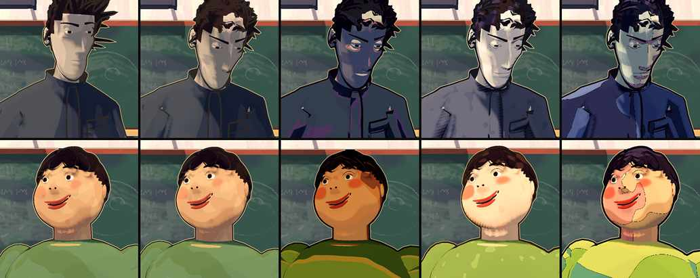
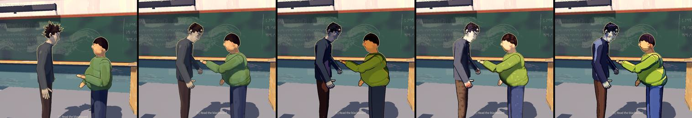
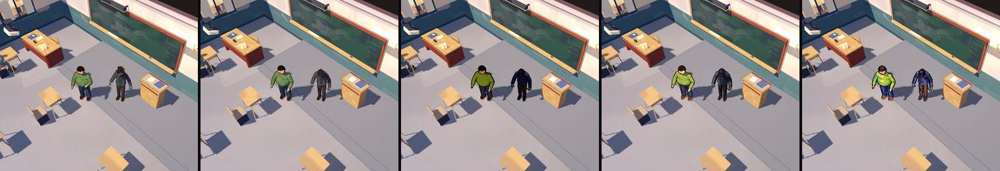
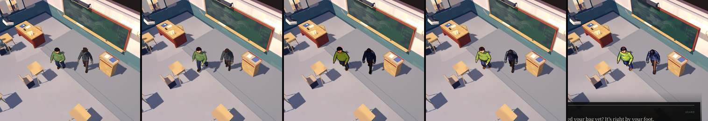
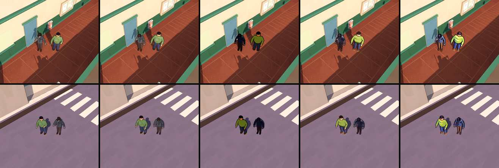
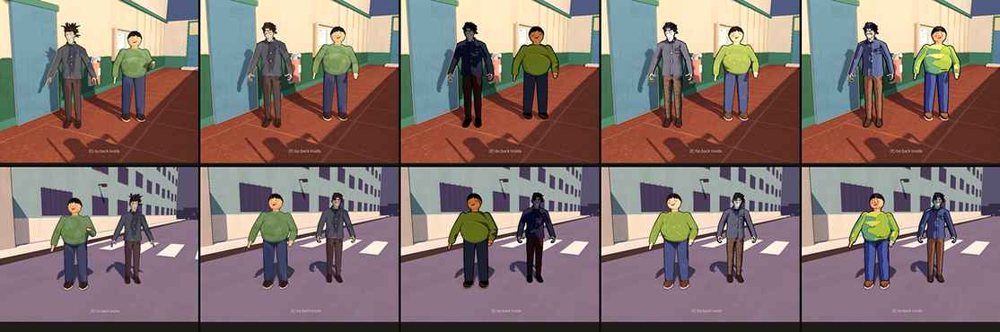

# 主角 / Q 角色美术深度评审与表现主义视觉实验（Issue #188）

> 这是一份评审文档，**不修改生产资源**。生产 GLB、Blender 源文件、骨骼、蒙皮、动画库、运动配置（motion profile）、生产着色器、`CharacterLook`、对话 UI、剧情文件、`DialogueController` 和 `ReadLog` 都没有改动。所有实验都放在 `scenes/dev/character_art_review/`（不进入导出包），运行时挂到生产包装场景上，用完即撤销。
>
> 文中所有图片都是 Godot 4.7.2 在 CI 中实际渲染的游戏画面：`main.tscn` 打完开场对话后的真实教室、走廊、街道，使用游戏自己的灯光和镜头。它们来自工作流 `character-art-review-capture.yml` 的 run 43801219041（提交 `d62a705`），由作业发布的 annotation 原样拼回，未作任何修饰。没有一张是示意图或生成图。

## 0. 结论先行

1. **当前的 C 方案不够。** 正常游戏镜头下，C 与原始 PBR（A）几乎无法区分：颜料块、脸部色块、墨线都在 60 像素高的人物上消失了。近景下它是"卡通三段光 + 噪声"，Q 的脸仍然是光滑的黏土 / 塑料感。主角最响亮的造型元素是一头向上炸开的尖刺头发，读起来像精力旺盛的动漫主角，和"疲惫、蜷缩、内向"正好相反。
2. **真正决定可读性的是身体，而不是表面。** 本次实验里最有效的一项是实验 A（身体语言叠加层 + 头发软化），它在正常镜头、行走、近景和对话中都能被看出来。三个表面方向在正常镜头下的差别只剩整体明度和色相。这与 `ART_BIBLE` 的优先级（轮廓 > 比例 > 姿态 / 动作 > 服装色 > 脸）一致。
3. **三个表面方向中，D3「表现主义色面」最贴近项目的心理 / 文学气质**，尤其是主角脸上冷绿、灰蓝的色面，在近景里第一次让他显得"病态、疲惫"而不是"干净的卡通脸"。D1「舞台光」的心理张力最强，但会把人物从场景里剥离；D2「炭笔 + 油画棒」在当前分辨率下效果最弱。
4. **建议下一步（按优先级）：** ① 把实验 A 的姿态和行为落进生产（这需要另开 Issue，并改动运动配置或增加生产修改器）；② 主角头发轮廓改为下垂、软化（需要所有者决定：改 Blender 源文件，还是接受运行时变形）；③ 在 C 的结构上只吸收 D3 的"冷暖色相面"做主角脸部，并采用可变线宽墨线，**近景专用**。不建议整体替换 C，也不建议冻结。

## 1. 评审方法

| 项 | 做法 |
|---|---|
| 场景 | 真实游戏：`main.tscn` → 开场对话打完（`MET_Q`）→ 玩家获得控制。教室取黑板前；走廊和街道用 `LocationHost.load_location` 加载，并沿用场景自己的光照 |
| 镜头 | 正常镜头 = 游戏自己的 `CameraRig/Camera3D`（offset (3.4, 6.4, 3.4)，FOV 60）；全身 = 过道 2.7 m；脸部 = 0.8 m、略低于眼睛（对话近景的取景方式）；对话 = 两人相距约 0.84 m、相向而立 |
| 对照列（每张图从左到右） | **C** 生产外观 + 生产姿态（基线，未改动）／**C+A** 生产外观 + 实验 A／**D1** 舞台光 + A／**D2** 炭笔油画棒 + A／**D3** 表现主义色面 + A |
| 自动检查 | `tests/character_art_review_test.gd`（Xvfb + OpenGL）：6 个外观的每个 shader 参数都必须在对应着色器中声明；每个表面都被替换（`kept` 为空）；叠加层强度 0 时骨骼姿态与生产完全一致；手、肩、手指按设计移动；停步会触发迟疑；头发软化与恢复均正确 |
| 复现 | 所有者在本地用编辑器打开 `scenes/dev/character_art_review/character_art_review.tscn`，按 F6 运行（按键说明见第 7 节） |

### 1.1 本次发现的一个采集缺陷（影响此前的 C 截图）

开场结束后，游戏会让主角**保持坐姿，直到玩家第一次主动移动**（`PlayerController._wake_seated`）。生产采集脚本 `tests/capture_character_art.gd` 用 teleport 摆放人物，不会触发这次"第一次移动"，所以它的 bodies / faces / gameplay 截图中，主角其实一直在播放 `sit_idle`：他半蹲着站在过道里，膝盖弯曲约 82°。本次第一轮采集也出现了同样的问题（日志 `Model: state walk, clip sit_idle`）。评审采集已改为通过玩家公开的 `settle_wake_pose()` 让他站起（日志 `protagonist stood up: clip sit_idle -> idle, seated false`）。

**影响：** 此前基于生产采集对 C 的部分判断（"驼背的一团暗色"）有一部分是坐姿造成的假象。建议另开一个小 Issue，在生产采集里同样先调用 `settle_wake_pose()`。本 PR 不修改生产测试脚本。

## 2. 证据：截图

所有截图位于 `docs/character_art_review/sheets/`。

### 2.1 全身（3/4 侧面，教室）

上排为主角，下排为 Q，列顺序均为 C / C+A / D1 / D2 / D3。

### 2.2 姿态本身：C 与 C+A，正面与侧面

每排依次为：正面 C、正面 C+A、侧面 C、侧面 C+A。上排主角，下排 Q。

### 2.3 脸部近景（对话距离、略低于眼睛）

### 2.4 对话：两人相距约 0.84 m，A 的 `converse` 行为开启（C 列不开启）

### 2.5 正常游戏镜头（站立）与行走中

行走帧中，人物以上报的行走速度原地播放行走片段，镜头保持不动。

### 2.6 不同光照：走廊（上）与街道（下）

## 3. 回答所有者的核心问题

| 问题 | 结论（依据见第 2 节截图） |
|---|---|
| 主角是否读起来疲惫、蜷缩、内向、身体紧绷？ | **C：部分可以。** 侧面能看到前伸的头和含胸，但正面仍是 A 字摊开的双臂和张开的手，加上向上炸开的头发，整体显得"摊开"而不是"收紧"。**C+A：明显更好。** 正面双臂贴向身体，双手半握，肩膀上提，头更低；对话时会转开身体和视线。头发软化后，整个人的轮廓从"炸开"变成"压低" |
| Q 是否放松、外向、过度熟络（带一点让人不适的贴近）？ | **C：只靠整体圆胖和右前臂的常驻手势**。那只永久前伸的右手读起来像"在展示什么"，而不是放松。**C+A：右手放下，身体更松**，对话时前倾，并把手伸向对方的上臂。"侵入对方空间"能读出来，但手臂过直，像是在"指"或"拦"，还不够自然（见第 6 节） |
| 两人的身体语言是否有区别？ | 静态轮廓区别明显（瘦高深色 vs 圆胖绿色），但这主要来自体型和服装色，而不是姿态。A 加上之后，"收紧 vs 松开"和"避开 vs 靠近"才开始成为可读的对比 |
| 是否还是"塑料 3D"感？ | **C 是。** Q 的脸尤其明显：光滑球面加上粉色腮红块。D3 最能打破这种感觉，D1 次之，D2 效果最弱 |
| 正常镜头下是否可读？ | 四种表面在正常镜头下几乎看不出区别，只剩明度和色相。D1 的主角在每个场景都接近一团黑影；D2、D3 的 Q 变得偏酸绿。正常镜头下能读出的东西是：轮廓、姿态、两人之间的明度 / 色相对比 |
| 近景与游戏镜头的区别、肖像与 3D 的关系 | 近景已经能读出表情（主角皱眉、抿唇的混合形状由外观设置），但 C 的脸部色块（主角眼下的青紫）只在近景可见。对话肖像是独立的 2D 美术，3D 模型不需要、也不应该去复制肖像。3D 的职责是让游戏镜头下的身体先成立 |

## 4. 三个视觉方向

所有方向共享同一套机制：`CharacterLookApplier.look` 指向一个评审用 `CharacterLook`，再调用 `apply_treatment(PAINTED)`，与生产外观的流程相同。墨线统一使用 `review_outline.gdshader`（倒壳描边，增加了线宽变化、断线和"抖动重画"三个参数）。

### D1「舞台光」 `review_stage_light.gdshader`

- **方案：** 每个角色自带一盏在视空间里定义的主光。主角用高顶光：眉骨和眼窝落进阴影，腿部沉进暗池。Q 用低位脚光：照亮肚子和脸的下半部，造成"太近、略诡异"的效果。光影是两块硬明度，明暗交界处有一条饱和的"核心色"带，阴影使用绝对颜色而非压暗的固有色。72% 的结果走 EMISSION（角色自己的光），其余部分接受房间灯光（两段）。
- **优点：** 心理张力最强、最戏剧化。近景下主角的冷紫脸和深眼窝最有"被审视"的压迫感，Q 的暖橙脚光读起来正是"贴得太近"。
- **缺点：** 人物与场景光脱节，走廊、街道、教室里都长一个样。正常镜头下主角接近黑影（全身像素平均亮度只有 0.15，C 为 0.27）。另外，以 EMISSION 为主的做法会让人物在暗场景、门、遮挡渐隐（`OcclusionFader`）中显得"发光"，需要额外处理。
- **适用范围：** 适合用作**对话 / 剧情近景的局部手段**（例如 `stage_share` 降到 0.2–0.3，只在对话镜头中启用），不适合作为常驻外观。

### D2「炭笔 + 油画棒」 `review_pastel.gdshader`

- **方案：** 屏幕空间排线锚定在角色身上（像画在人物上面，而不是印在衣服上）。排线间距按像素钳制在 3.2–11 px，最暗处叠加交叉线，以每秒 6 次的频率"抖动重画"。亮部是蜡质油画棒的颗粒感，鼻子、耳朵、指节等处用原色点染。
- **优点：** 最接近"手绘、未完成"的媒介感，抖动重画在运动中有生命力（静帧看不出来）。
- **缺点：** 在 1600×900 的游戏镜头下排线几乎不可见，只剩一层发白的灰。近景下人脸发粉白、像石膏。第一轮里 Q 下巴上的排线读成了胡茬，衣服颗粒读成了迷彩，两者都已调弱，但这正说明这个方向难以控制。它也是三者中渲染开销最高的（见第 5 节）。
- **适用范围：** 不建议作为角色主外观。可以考虑把它局部用于"心理事件"的过场效果。

### D3「表现主义色面」 `review_color_planes.gdshader`

- **方案：** 按蒙皮后的模型空间法线，把每个片元分到五个"色面"之一（左前主面、右前侧面、顶面、底面、背面），并用静止姿态噪声打碎边界，得到切削感的折线边。每个面的颜色是不同的色相，而不只是明暗差，并且固定在身体上，例如主角右颊永远是那片冷绿。近距离时色面边界刻入一条细"凿线"，远距离淡出。房间灯光仍然决定明度（两段），阴影偏向 `shade_tint` 的色相。
- **优点：** 最像"画出来的人"，最接近 Schiele、Kirchner 的气质。主角脸上的冷绿 / 灰蓝色面，第一次让他在近景里显得"苍白、疲惫、不舒服"，而且这种效果来自颜色本身，不依赖贴图或 UV。Q 的暖橙 / 粉色面让他更"热"、更"满"。
- **缺点：** 色面的位置由法线和噪声决定，不由解剖结构决定。在 Q 的大圆脸上，一条切边会落在脸颊中间，读起来像疤痕或胎记。已经把 Q 脸部的抖动从 0.38 降到 0.08，仍然能看到。正常镜头下 Q 的毛衣偏酸绿。
- **适用范围：** **最值得继续的表面方向**，但应该只吸收它的核心思路：近景下用色相面代替单色明暗，主角脸部优先，并且色面边界最好由作者绘制（顶点色或 Blender 中手绘面分区），不再依赖噪声。

### 实验 A「身体语言」 `pose_overlay.gd` + 头发软化

- **方案：** 一个 `SkeletonModifier3D`（与生产的 `NpcGaze` 同类），挂在角色骨架下，在生产动画之后、绕各关节、按角色空间轴叠加旋转。它不改片段、不改运动配置，强度为 0 时与生产姿态完全一致（测试中的超出量为 0.000000）。
  - 主角：锁骨上提并前卷（各 12.7°）、颈前伸 7°、头低 6°、胸 4°；上臂内收 13.6°，前臂屈 13.4°；手指半握（食指 87°）；眼睛向下 9°。停步后有约 1.7 s 的"迟疑"：头转向一侧、肩再提。起步的前 0.6 s 头更低、手臂更紧。躯干对速度变化的反应僵硬、阻尼大。对话时身体、头和视线转离对方，靠近对方一侧的肩膀上提。
  - Q：右前臂放下 52°（去掉模型自带的常驻前伸手势），头歪 6°、下巴略抬；躯干带惯性，停步时前后晃动；行走时重心在两脚间左右滚动，站立时缓慢摇摆。对话时前倾 11°，转向对方，并把手伸向对方的上臂。
  - 头发：主角头发网格在静止空间里，把离头骨中心超过 0.10 m 的顶点收回并下垂（1202 个顶点；最远点从 0.199 m 降到 0.141 m），只改内存中的网格，GLB 不动。
- **结果：** 正面"收紧"和行走中的"手臂贴身"在游戏镜头下也能看出来，是本次唯一在所有距离上都有效的改动。
- **局限：** Q 伸手只转动了肩关节，手臂是直的；迟疑、惯性、摇摆等行为只能在运行时看到，静帧无法证明（请在评审场景中按 W 观察）。

## 5. 性能

| 镜头 | C | C+A | D1 | D2 | D3 |
|---|---|---|---|---|---|
| 游戏镜头（中位数 ms／帧，含回读） | 352.8 | 352.2（−0.2%） | 355.3（+0.7%） | 357.6（+1.4%） | 356.0（+0.9%） |
| 对话近景（中位数 ms／帧，含回读） | 271.3 | 273.7（+0.9%） | 279.2（+2.9%） | 289.1（+6.6%） | 285.6（+5.3%） |
| Draw calls／图元（游戏镜头） | 2243／680270 | 相同 | 相同 | 相同 | 相同 |

- **测量方式：** 在 CI（Mesa llvmpipe 软件光栅、Xvfb、OpenGL 兼容渲染器）中，对同一帧强制绘制并回读 24 次，取中位数（数据来自 run 43801219041 的测量 annotation）。**绝对数值不代表玩家的 GPU**。另外，同一配置在不同 run 之间相差很大（run 43800781584 中游戏镜头的 C 为 268.5 ms），所以只有同一 run 内的相对差异有参考价值，而且只能作粗略参考。
- **可以确定的部分：** 四个方向的 draw call 和图元数与 C 完全相同（每个表面一个材质，加上同样的描边 pass）。差别只在片元着色器的复杂度上。人物在屏幕上占比越大，差别越明显，因此近景下 D2 最贵、D3 次之。
- **未测量的部分：** 真实 GPU 的耗时；姿态叠加层单独的 CPU 开销（每帧约 20 个骨骼的矩阵乘法，预计可以忽略，但没有单独测量）。头发软化在每次 `apply` 时重建一次网格，结果有缓存，不是每帧的开销。
- **所有者自测：** 评审场景的 HUD 会显示 GPU 渲染时间（已开启 `viewport_set_measure_render_time`）、draw call 和图元数。在 Windows 目标机上按 1–5 切换方向即可对比。

## 6. 已知问题与风险

- Q 的"伸手"是直臂，需要加入肘部弯曲和手腕朝向，才能读成"拍肩、搭手"，而不是"指人"。
- D3 色面边界由噪声决定，在 Q 的大圆脸上会切出疤痕状的边。生产化时应改为作者绘制的分区。
- D1 以自发光为主，会削弱场景光、遮挡渐隐和阴影的存在感，需要所有者在气质上做取舍。
- 实验 A 中依赖时间的行为（迟疑、惯性、行走滚动、摇摆）无法用静帧证明，需要所有者在评审场景中亲自观察。
- 头发软化是运行时变形，若要进入生产，正确做法是在 Blender 源文件中改造型（需要所有者授权）。
- 评审场景（`character_art_review.tscn`）里的三套灯光只是近似，真实场景光以 CI 截图为准。本 PR 未在 Windows 上运行过该场景。

## 7. 所有者本地复现

1. 用 Godot 4.7.2 打开项目，打开 `scenes/dev/character_art_review/character_art_review.tscn`，按 F6 运行。
2. 按键：
   - `1`–`5`：C / C+A / D1 / D2 / D3
   - `V`：游戏镜头 / 对话双人 / 脸部
   - `W`：原地行走 / 停（主角停步后会迟疑）
   - `T`：Q 走近对话 / 退回
   - `L`：三套近似光
   - `H`：隐藏或显示 HUD
3. 若要在真实游戏中复现截图，可在 GitHub Actions 中重跑 `Character art review capture` 工作流。

## 8. 建议拆分的后续 Issue（供所有者决定）

1. **姿态生产化：** 把实验 A 中静态姿态的部分写进 `protagonist_motion.tres` 和 `q_motion.tres`（或增加一个生产 `SkeletonModifier3D`），包括锁骨、手指、Q 右前臂；把动态行为（迟疑、惯性）做成可开关的层。
2. **主角头发轮廓：** 在 Blender 源文件中把尖刺改为下垂、压低的造型（需要所有者授权修改模型）。
3. **近景脸部色相面：** 在 C 的着色器中加入作者绘制的冷暖色相分区（顶点色），只在近景生效，主角优先。
4. **可变线宽墨线：** 采用 `review_outline.gdshader` 的线宽变化和断线（不使用抖动重画），近景生效。
5. **采集修正：** 在 `tests/capture_character_art.gd` 中先调用 `settle_wake_pose()`（见 1.1 节）。
