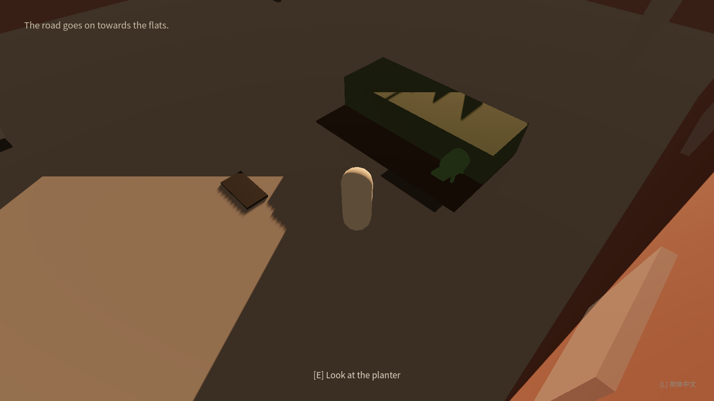
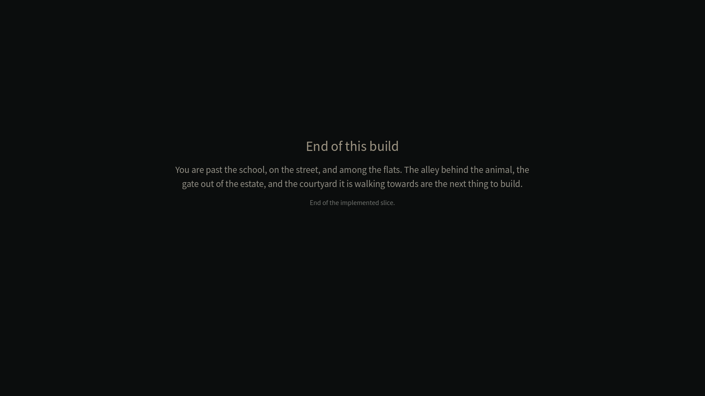
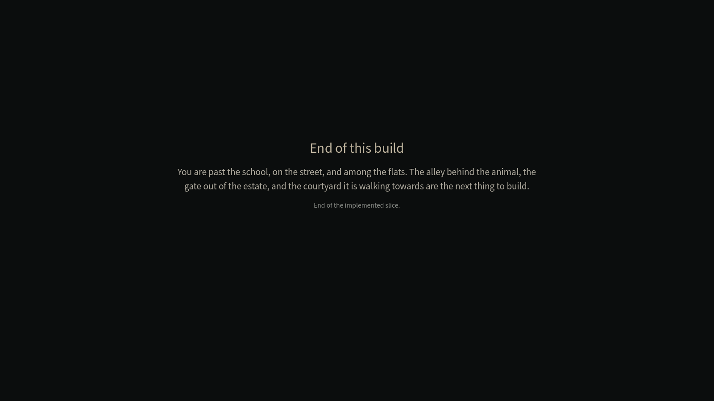

# Playthrough screenshots

Captured by `tests/capture_playthrough.gd` in a real Godot window under
Xvfb (`--rendering-driver opengl3`, 1600x900). Interaction, dialogue
advance, choice selection and the language switch were produced with
simulated key events; walking between scenes was shortened with
teleports so the capture fits in CI. Regenerate with the
`Playthrough capture` workflow.

## 01_opening_line

The first line of the opening conversation, in English.

## 02_walking

The player after holding the forward key.

## 03_world_after_opening

The classroom with control returned and the objective set.

## 04_prompt_schoolbag

The interaction prompt with the key that is bound in the input map.

## 05_inspection_text

The schoolbag description, reached by pressing E.

## 06_chinese_world

The same classroom after switching to simplified Chinese at runtime.

## 07_prompt_chinese

The interaction prompt after the switch

## 08_repeat_read_chinese

The second read of the same object, in Chinese.

## 09_prompt_talk_chinese

The prompt for a conversation, in Chinese.

## 10_conversation_chinese

A conversation line in Chinese, opened with E.

## 11_back_to_english

The same scene after switching back to English.

## 12_door_prompt

The classroom door is open

## 13_corridor

The walkway outside the classroom.

## 14_street

The street outside the school gate, with the arrival line finished.

## 15_street_prompt

A street object with its prompt.

## 16_street_inspection

The street object's description.

## 15b_stair_prompt

The way up to the residential area.

## 17_residential

The courtyard behind the school

## FAIL_animal_prompt

No prompt appeared for the animal.

## 18_animal_prompt

The green animal, with the prompt to look at it.

## 19_animal_conversation

Meeting the animal

## 20_end_card

The end-of-slice card at the end of the built content.

## FAIL_last_frame

The last frame before the capture stopped.

